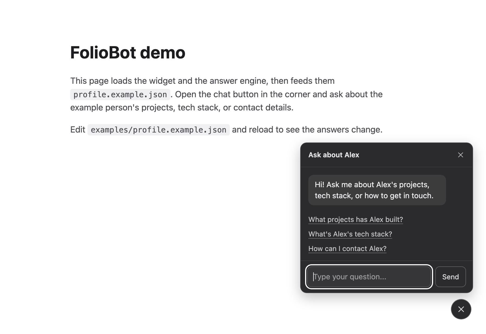

# FolioBot

An embeddable chat widget that answers questions about you, built from a single `profile.json`.
Drop in a `<script>` tag, describe yourself once, and visitors to your portfolio can ask about your projects, tech stack, and how to reach you.

> **Status: early.** The widget and a scripted (no-AI) answer engine work today. The AI backend is in progress; see the roadmap below.



## What works today

- **Widget** ([`widget/`](widget)): one dependency-free file (`foliobot.js`), Shadow DOM so your site's CSS cannot break it, accessible (dialog role, live region, Esc to close, reduced-motion aware), and messages are rendered without `innerHTML`. Light, dark, auto (follows the visitor's system setting) and custom-colour themes.
- **Profile engine** ([`widget/profile-engine.js`](widget/profile-engine.js)): turns a `profile.json` into scripted answers. No network, no cost, no API key.
- **Schema** ([`schema/profile.schema.json`](schema/profile.schema.json)): the shape of `profile.json`, with editor autocomplete and validation. Start from [`examples/profile.example.json`](examples/profile.example.json).

## Quick start

```html
<script src="widget/foliobot.js"></script>
<script src="widget/profile-engine.js"></script>
<script>
  fetch('profile.json').then(function (r) { return r.json(); }).then(function (profile) {
    FolioBot.init(FolioBot.fromProfile(profile));
  });
</script>
```

To load the files from a free CDN instead of copying them, see [Use it from a CDN](widget/README.md#use-it-from-a-cdn-free). Full options and the backend contract are in [`widget/README.md`](widget/README.md).

### Customize the opening message

The header, the first message and the suggested questions come from the `bot` block of your `profile.json`:

```json
"bot": {
  "title": "Ask about Alex",
  "greeting": "Hi! Ask me about Alex's projects, tech stack, or how to get in touch.",
  "suggestions": ["What projects has Alex built?", "How can I contact Alex?"]
}
```

Set `"greeting": ""` to open on the suggestions alone. Each suggestion needs an answer in your profile; see [Customize the opening message](widget/README.md#customize-the-opening-message) for how to make sure it has one.

### Match your site

The widget follows the visitor's light/dark system setting by default. Pass a second argument to `fromProfile` to fix the theme or use your own colours:

```js
FolioBot.init(FolioBot.fromProfile(profile, {
  theme: 'custom',                  // 'auto' (default), 'light', 'dark' or 'custom'
  colors: {                         // used by 'custom'
    background: '#0f172a',
    text: '#e2e8f0',
    accent: '#38bdf8'               // optional hover and focus colour
  }
}));

FolioBot.setTheme('light');         // switch later, e.g. from your site's own theme toggle
```

Borders, bubbles and muted text are derived from `text`, so two colours are enough. Hover is neutral by default (it brightens to the theme's text colour); set `accent` for a brand colour in every theme. You can also theme it from your stylesheet with CSS variables. See [Theming](widget/README.md#theming).

## Try it

Serve the repo over HTTP (the demo loads its profile with `fetch`, which browsers block on `file://`):

```bash
python3 -m http.server
```

Then open <http://localhost:8000/examples/demo.html>. Edit `examples/profile.example.json` and reload to change the answers. The theme menu on the page switches the widget between auto, light, dark and a custom example.

## Tests

The answer engine and the widget's config logic (themes, colours, greeting) have a dependency-free test suite using Node's built-in runner (Node 18 or newer):

```bash
node --test tests/*.test.js
```

The widget tests run against a small fake DOM, so they check what the widget sets, not how it looks. Check visual changes in the demo page.

## Roadmap

| Area | Plan |
| --- | --- |
| `server/` | Python (FastAPI + Pydantic) backend that answers from the profile using an LLM |
| Retrieval | Embed the profile and retrieve only the relevant parts per question |
| Tool calling | Let the model fetch structured facts (links, stacks) instead of guessing |
| `evals/` | A test suite of in-scope, out-of-scope, and prompt-injection questions, with pass rates tracked per version |
| Ingest | A CLI that builds a `profile.json` from a resume, Markdown, or URL, for you to review before use |
| Packaging | CDN / npm release for the widget |

The step-by-step learning log is in [`docs/LEARNING.md`](docs/LEARNING.md).

## Security notes

- Everything in `profile.json` ends up in a public widget or prompt. Do not put a phone number, salary, or home address in it.
- API keys belong in a server environment variable, never in the widget or this repo.
- Any public chat endpoint needs rate limiting, input and output caps, and a spending cap. An `Origin` check helps against casual misuse but is not a security boundary.

The full threat model, and what is implemented versus still required, is in [`docs/SECURITY.md`](docs/SECURITY.md).

## License

[MIT](LICENSE)
